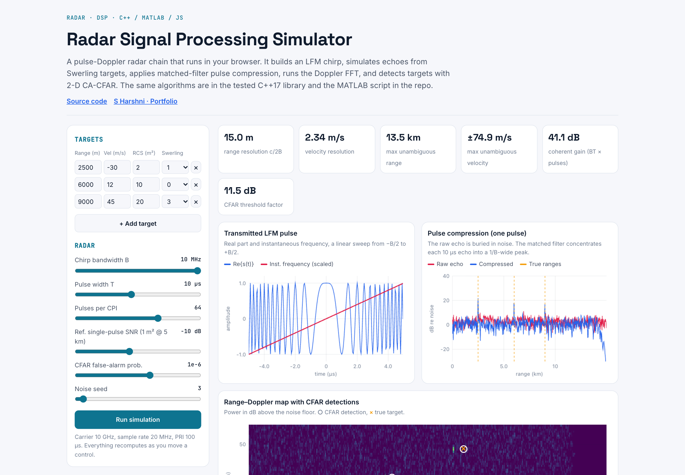
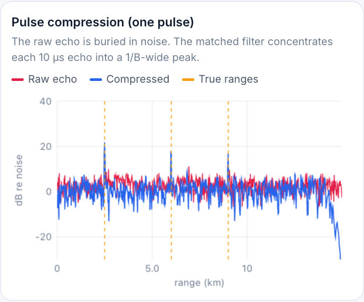
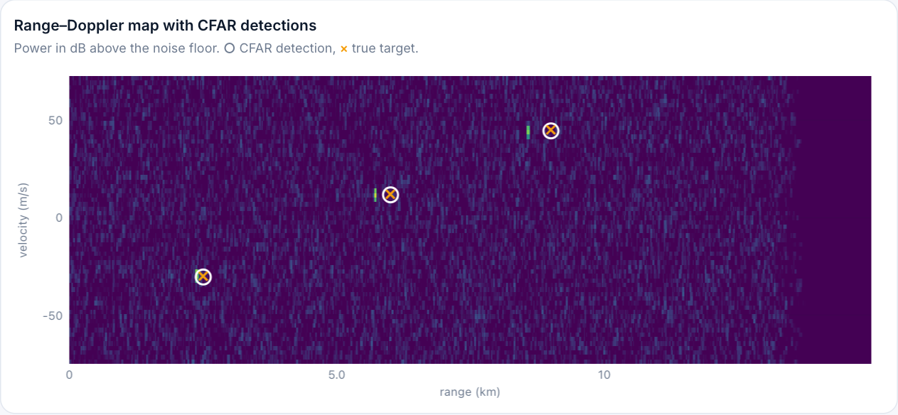

# Radar Signal Processing Simulator

[](https://github.com/S-Harshni/Radar-Signal-Processing-Simulator/actions/workflows/ci.yml)


[](https://s-harshni.github.io/Radar-Signal-Processing-Simulator/)

<!-- live-links -->
> 🔗 **Live demo:** [s-harshni.github.io/Radar-Signal-Processing-Simulator](https://s-harshni.github.io/Radar-Signal-Processing-Simulator/)  
> 👤 **Portfolio:** [s-harshni.github.io/S-Harshni](https://s-harshni.github.io/S-Harshni/)  
<!-- live-links -->



A pulse-Doppler radar signal-processing chain implemented three times: a tested **C++17** library, a **MATLAB** reference script, and a **JavaScript** port that powers the interactive browser demo.

```
LFM chirp ─► target echoes ─► pulse compression ─► Doppler FFT ─► 2-D CA-CFAR ─► detections
             (Swerling RCS,     (FFT matched filter,   (per range bin,    (guard/training
              delay, Doppler,    Hamming weighting)     Hamming window)     cells, Pfa)
              AWGN)
```

## What it covers

| Topic | Where |
|---|---|
| **LFM waveform**: baseband chirp `s(t) = exp(jπ(B/T)t²)`, sweep −B/2 → +B/2 | `lfm_pulse` |
| **Target models**: two-way delay, Doppler `fd = 2v/λ`, radar-equation amplitude (SNR ∝ σ/R⁴), **Swerling 0–IV** RCS fluctuation | `simulate_echoes`, `draw_rcs` |
| **Pulse compression**: FFT-based matched filter (correlation), Hamming weighting for sidelobe control | `pulse_compress` |
| **Doppler processing**: slow-time FFT per range bin, windowing, `fftshift` | `range_doppler_map` |
| **Detection**: 2-D **cell-averaging CFAR**, threshold `α = N(Pfa^(−1/N) − 1)`, local-maximum peak picking | `cfar_2d` |
| **FFT**: iterative radix-2 Cooley–Tukey, written from scratch | `fft.hpp` |

Default radar: 10 GHz carrier, B = 10 MHz, T = 10 µs, fs = 20 MHz, PRI = 100 µs, 64 pulses →
range resolution **15 m**, max range **13.5 km**, velocity resolution **2.34 m/s**, unambiguous velocity **±74.9 m/s**, coherent gain **41 dB**.

## Screenshots

| Pulse compression | Range–Doppler map + CFAR |
|---|---|
|  |  |

The raw echoes (red) sit at the noise floor. After matched filtering (blue), each 10 µs echo collapses to a 1/B-wide peak at the true range. On the range–Doppler map, the CFAR detections (○) land on the true targets (×).

## Build & test (C++)

```bash
make test                 # builds and runs the unit tests
make run                  # default 3-target scenario
./build/radar_sim --seed 7 --target 4000 20 5 1 --csv rd_map.csv
```

`--target R V RCS SWERLING` can be repeated. `--csv` writes the range-Doppler map in dB.

The tests check the implementation against theory:

- FFT: tone lands in the right bin with magnitude N; `IFFT(FFT(x)) = x`; Parseval's theorem
- Chirp: 200 samples, constant envelope, sweeps −B/2 → +B/2; range resolution c/2B = 15 m
- Pulse compression: peak at the round-trip delay, processing gain ≈ BT, mainlobe ≈ 1/B wide
- Range-Doppler: range within one resolution cell, velocity within one Doppler bin
- CFAR: measured false-alarm rate ≈ design Pfa (**1.08 × 10⁻³ measured vs 10⁻³ designed**), and all targets detected
- Swerling: sample mean and variance match the exponential (I/II) and 4-DOF chi-square (III/IV) models

Example run:

```
Range res 15.0 m, max range 13.5 km | velocity res 2.34 m/s, max +/-74.9 m/s

Truth:                                        CFAR detections (Pfa 1e-6):
    2500.0 m   -30.00 m/s  Swerling 1             2503.3 m   -30.45 m/s  SNR  33.4 dB
    6000.0 m    12.00 m/s  Swerling 0             6003.3 m    11.71 m/s  SNR  32.0 dB
    9000.0 m    45.00 m/s  Swerling 3             9001.3 m    44.50 m/s  SNR  26.6 dB
```

## MATLAB

`matlab/radar_simulation.m` runs the same chain in base MATLAB (no toolboxes) and plots the chirp, single-pulse compression and the range-Doppler map with detections. Requires R2016b+.

## Design notes

- Echoes are generated by evaluating the delayed chirp **exactly** at each sample. An earlier version linearly interpolated the sampled chirp for sub-sample delays; this distorted the envelope near the band edges and created paired false echoes after compression, which CFAR then detected.
- A single-pulse reference SNR of −10 dB (1 m² at 5 km) is realistic: the ~41 dB integration gain (pulse compression × Doppler) lifts targets well above the CFAR threshold. At very high SNR, a strong target's windowed range sidelobes (~−40 dB) can cross the threshold, which the demo lets you reproduce.
- With Hamming windows, neighbouring cells are correlated, so the measured false-alarm rate is slightly above the ideal CA-CFAR value at very low Pfa.

## Project layout

```
cpp/include/radar/fft.hpp      radix-2 FFT, Hamming window, fftshift
cpp/include/radar/radar.hpp    waveform, targets, pulse compression, Doppler, CFAR
cpp/tests/test_radar.cpp       unit tests
cpp/apps/radar_sim.cpp         command-line scenario runner
matlab/radar_simulation.m      MATLAB reference implementation
docs/                          interactive demo (GitHub Pages)
```
